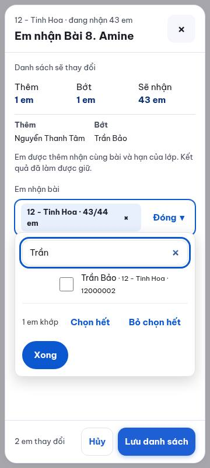
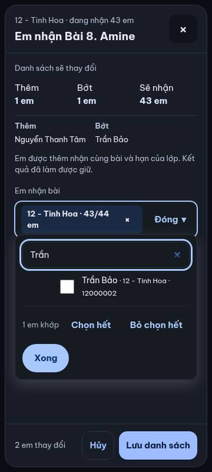
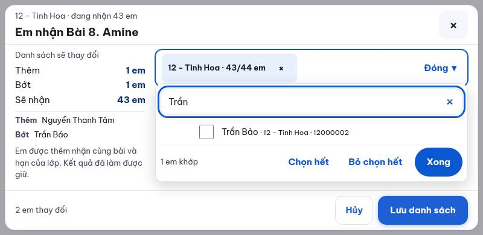
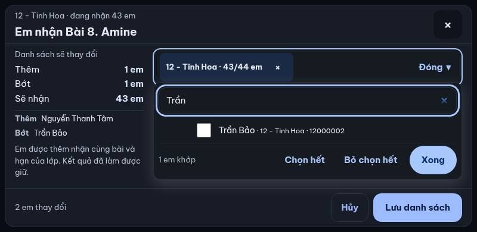
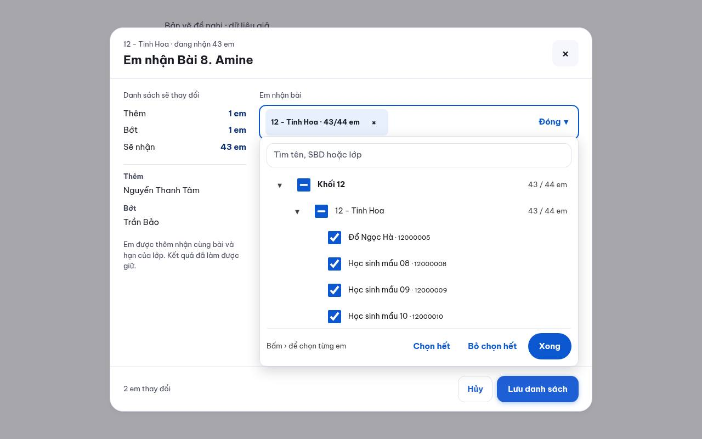
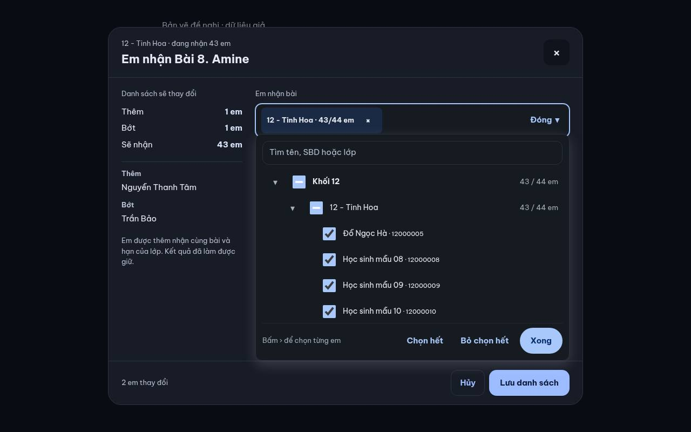

# Bản vẽ Thêm / Bớt em trong Tick bài

Đây là bản vẽ dùng dữ liệu giả, chưa nối API hoặc thay đổi danh sách học sinh thật. Thầy duyệt bố cục trước khi build theo [AGENTS.md mục 3](../../AGENTS.md#3-quy-trình-4-bước-thầy-đồng-ý-1310).

Thầy mở **Thêm / Bớt em** ngay cạnh **Sửa hạn** tại bài/lớp cần chỉnh. Tấm chọn hiện danh sách đúng lớp, tên các em được thêm/bớt và số em sẽ nhận. **Lưu danh sách** giữ nguyên màn; bản thật chỉ hiện **Đã lưu danh sách** sau xác nhận đầy đủ của máy chủ. Em được thêm nhận cùng bài và hạn nộp; giữ lịch sử và thuật toán phân câu hiện tại.

Đặc tả đầy đủ: [7 mục và hợp đồng API](../them-bot-em-tick-1410.md). Đối chiếu phần còn thiếu: [bàn giao C2/C3](../doi-chieu-c2-c3-1410.md).

## Điện thoại dọc · 360 × 800

## Điện thoại ngang · 800 × 390

## Máy tính · 1280 × 800

## Bằng chứng kiểm bản vẽ

Ngày 14/10/2026, chạy lại Chromium trên main `bd4c5086`: 6/6 tổ hợp, không lỗi trang, không tràn ngang, không đích bấm nhỏ hơn 44 px, không chữ dưới ngưỡng tương phản đã kiểm, nút Lưu không bị che. [Số đo](ket-qua.json). Đây là kiểm bố cục bản vẽ; chưa chứng minh lưu D1 hoặc hành vi kế hoạch thật.

Chạy lại tại máy có Chromium và Playwright: mở Vite bằng `npx vite --config scripts/chup-tick-em-1410/vite.config.mjs`, rồi trong terminal khác chạy `node scripts/chup-tick-em-1410/chup.mjs`. Không gọi API thật.
