# Soát chữ chèn toàn bộ 3 app — 26/10/2026 (kết quả sau khi sửa)

Thầy 26/10 tối: «Chữ vẫn bị chèn, giao cho 1 tác tử check lại toàn bộ giao diện và sửa đúng chuẩn đẹp nhé». Luật thầy: KHÔNG cắt chữ để vừa, thẻ cao theo nội dung, trang được cuộn; chỉ đổi trình bày, màu chỉ dùng biến sẵn có.

- Bộ soát: `scripts/soat-chu-chen/` (9 loại lỗi a–j, Playwright + Chromium thật, dữ liệu giả `scripts/chup-v2`), 163 cảnh × 8 khổ (390×700, 360×640, 412×780, 390×844, 844×390, 740×360, 1024×768, 1440×900) × sáng/tối = **2 608 lượt**.
- Bỏ khỏi phạm vi (làn khác đang dựng lại): `ManLamBaiTap.tsx` / `trong-lam-bai.css` (cảnh `lam13`, `hs-lam`) và `ph-v3/DocPh.tsx` / `doc-ph.css` (cảnh `ph&mot=1`).
- Không thêm CSS vào tờ nạp lúc mở (`index.css`, `trong.css`, `trong-gv.css`, `ph-v3.css`): mọi luật mới nằm ở tờ nạp lười của từng màn (thêm một tờ lười `ph-v3/man-tien-bo.css` cho màn Tiến bộ cũ).

## Trước / sau (số dòng lỗi đã gộp: cùng màn + phần tử + loại ⇒ một dòng)

| Loại | Trước | Sau |
|---|---:|---:|
| a. Chữ bị cắt | 43 | 0 |
| h. Tràn ngang | 23 | 0 |
| c. Hai phần tử chồng nhau | 20 | 0 |
| f. Dòng mở đầu bằng «·» | 16 | 0 |
| d. Phần tử nổi/ghim che | 11 | 0 |
| g. Chữ vỡ mỗi từ một dòng | 7 | 0 |
| j. Ô rơi một mình xuống hàng | 6 | 0 |
| b. Chữ tràn khung | 6 | 0 |
| e. Chữ vượt lòng vòng | 1 | 0 |
| **a–j cộng (giao diện chính)** | **127** | **0** |
| Giao diện cũ (`ddh.trong=tat`, PH không «Một trang») | 28 | 0 |

«Trước» = bản đã gộp nhánh `claude/sua-chop-2610` (c4af218b), chưa sửa đợt 3–5 (2 552 lượt; 56 lượt cuối của app thầy chưa kịp chạy trước khi máy dừng lượt). «Sau» = đủ 2 608 lượt trên bản cuối. Còn ghi riêng, không tính lỗi: «a…» ba chấm cố ý ở dòng danh sách (69) và «i» đích bấm < 44 px (52).

## Ảnh trước / sau

| Màn | Trước | Sau |
|---|---|---|
| Chiếu điểm danh · điện thoại 390 |  |  |
| Tờ chiếu Chữa câu khó · 390 | 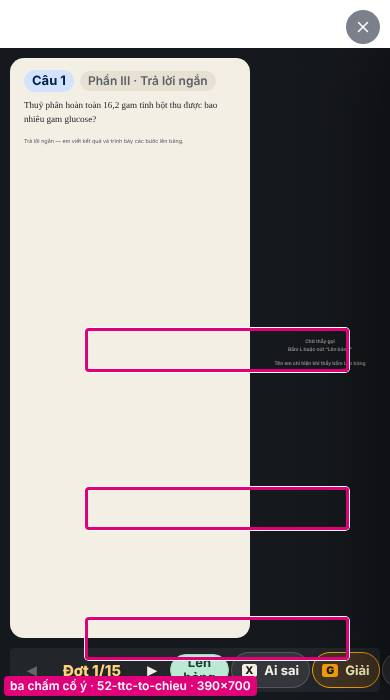 | 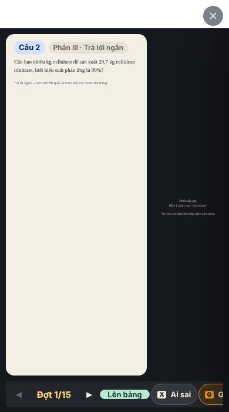 |
| Lên bảng (giao diện cũ) · 390 | 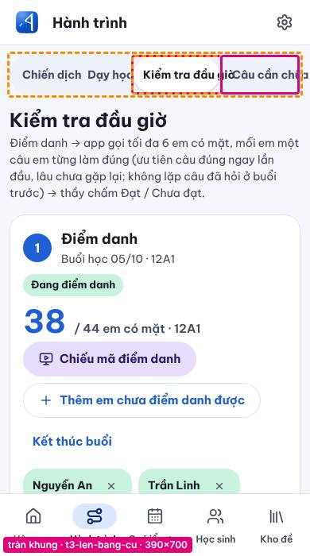 | 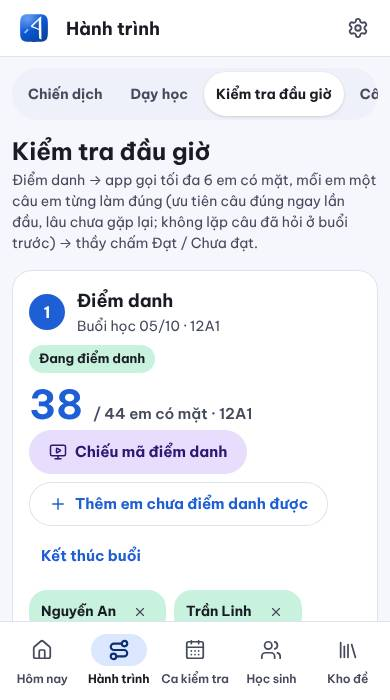 |
| Học sinh Hôm nay · 360 |  |  |

## Đã sửa (đợt 3–5)

- Chiếu điểm danh / Nhịp học của lớp trên điện thoại (dọc ≤ 600 px, ngang cao ≤ 560 px): một cột cuộn dọc — hết tràn ngang 146 px, hết cắt tên em và khối «Vừa vào lớp», chân không đè cột mã; «30/38» nằm trọn trong vòng; số to không chạm dòng nhỏ (`day-hoc/ban-chieu-sang.css`).
- Tờ chiếu ở màn hẹp (≤ 900 px): thanh dưới tự cuộn ngang trong chính nó, nút đủ chữ một dòng (`lib/giao-dien-to-chieu.ts`).
- «·» không mở đầu dòng (dấu cách cứng trước «·»): Chữa câu khó, Tự sửa lỗi, Kiểm tra đầu giờ, Học sinh «Một trang», Phụ huynh cũ.
- Học sinh máy tính bảng ngang: ô tìm một hàng, nút Tải lại không rơi một mình; Câu đã làm: viên lọc giãn đầy hàng; Kiểm tra ôn tập: chặng 7 câu chia 4 + 3; dòng «Sau đó» ≤ 400 px số xếp hai tầng.
- Điểm danh Mức làm: bốn nút lọc giãn đầy hàng, số «Sai vì vội» không chạm dòng nhỏ.
- Giao diện cũ: hàng thẻ Lên bảng cuộn ngang (hết chồng), mã buổi xuống dưới QR, Hôm nay của thầy thẻ việc nút xuống hàng + bốn ô Nhịp học hai hàng, Theo dõi ca tên em / link không «…», Phụ huynh cũ tên con không cắt, «75% đúng» không thò khỏi ô.
- Bộ soát: ô nhập chỉ tính vùng gõ chữ (nút ± , trong ô số không còn báo chồng); bỏ qua menu người dùng vừa bấm mở; `chup-v2` chờ đúng thẻ em của bản chiếu nền sáng và tiêu đề Tự sửa lỗi mới (hết chờ hụt 20 giây mỗi lượt).

## Còn để ý (không phải lỗi a–j)

- Thao tác cảnh hỏng sẵn (soát vẫn chạy trên trạng thái đạt được): `83-dd12c-chieu-ho-so-em` (hộp hồ sơ không hiện «Số lượt làm câu»), các cảnh `hse-*` lười của học sinh (hệ lười đã ẩn khỏi app học sinh 26/10), một số cảnh `cb:` / `ttc-chieu:…:x` / `hn:` — cần cập nhật `scripts/chup-v2/chup.mjs` theo màn mới.

---

# Phụ lục — bảng lỗi TRƯỚC khi sửa (sinh tự động bằng `bao-cao.mjs`)

Thầy 26/10 tối gửi ảnh điện thoại thật: «Chữ vẫn bị chèn, giao cho 1 tác tử check lại toàn bộ giao diện và sửa đúng chuẩn đẹp nhé». Báo cáo này là GIAI ĐOẠN 1 (chỉ soát, chưa sửa mã app).

- Bộ soát: `scripts/soat-chu-chen/` (Playwright + Chromium thật, dữ liệu giả của `scripts/chup-v2`). Chạy: `npx vite build --config scripts/chup-v2/vite.config.mjs --outDir <dist>` rồi `node scripts/soat-chu-chen/soat.mjs <dist> <ra>` và `node scripts/soat-chu-chen/bao-cao.mjs <ra> docs/soat-chu-chen-2610.md docs/anh-soat-2610`.
- Phạm vi: 160 cảnh (mọi cảnh của `chup.mjs` gộp theo màn + thao tác, thêm cảnh chỉ có ở `trang.tsx` và khối `// ═══ SOÁT 26/10`) × 8 khổ (390×700, 360×640, 412×780, 390×844, 844×390, 740×360, 1024×768, 1440×900) × sáng/tối = 2552 lượt. Bỏ cảnh ép nút Sáng/Tối trong Cài đặt (trùng bố cục).
- Gộp trùng: cùng màn + cùng phần tử + cùng loại (+ cùng mẫu chữ, số thay bằng #) ⇒ MỘT dòng, cột «Khổ bị» liệt kê khổ gặp lỗi. Con số đếm dưới đây là số dòng ĐÃ GỘP.
- Giao diện cũ (lùi bằng `ddh.trong=tat`, phụ huynh không «Một trang») báo riêng ở cuối, không tính vào tổng.

## Cách bộ soát nhận lỗi

| Loại | Nhận thế nào |
|---|---|
| a. Chữ bị cắt | Dòng chữ (khung chữ thật của từng dòng) thò ra ngoài tổ tiên có `overflow: hidden/clip` gần nhất ⇒ phần chữ mất. Ba chấm (`text-overflow: ellipsis`/`line-clamp`) ở dòng danh sách ⇒ nhóm riêng «a…»; ba chấm trong nút, thẻ, tiêu đề vẫn là lỗi a (ảnh thầy «họn để x…»). |
| b. Tràn khung | Chữ thò ra ngoài khung có nền hoặc viền gần nhất (khung không cắt) > 2px. |
| c. Chồng nhau | Hai dòng chữ / chữ và nút / hai nút giao nhau > 2px mỗi chiều, bỏ cha–con, bỏ phần bị cắt khuất, bỏ nút trong suốt phủ cả thẻ (mẫu «cả thẻ bấm được»). |
| d. Nổi/ghim che | `elementFromPoint` tại tâm dòng chữ/nút trả về phần tử thuộc khối `fixed`/`sticky` khác: cuộn về ĐẦU xét thanh trên + cạnh, cuộn tới ĐÁY xét thanh đáy + nút nổi (không hé ra được dù cuộn hết); trang không cuộn ⇒ xét mọi phần tử nổi. |
| e. Chạm lòng vòng | Vòng SVG (`circle` có nét, lấy bán kính trừ nửa nét) hoặc ô tròn CSS (`border-radius` ≥ 50%, gần vuông): bốn góc nét chữ (cao 0,72 cỡ chữ) phải nằm trong lòng vòng. |
| f. «·» đầu dòng | Dấu «·» là ký tự nhìn thấy đầu tiên của một dòng hiển thị (xét ký tự trước trong cùng nút chữ, hoặc chữ khác cùng hàng ở bên trái). |
| g. Vỡ từng dòng | Khối chữ rộng < 80px mà > 3 dòng, hoặc ≥ 3 dòng mà trung bình ≤ 9 ký tự/dòng trong bề rộng < 140px. |
| h. Tràn ngang | Trang/tấm cuộn ngang, hoặc chữ/nút thò qua mép khung nhìn mà không nằm trong khung cuộn/cắt ngang. |
| i. Đích bấm < 44px | Nút, đường dẫn, ô nhập hiển thị có cạnh < 44px (đếm riêng, không ảnh). |
| j. Ô rơi hàng | Hàng flex-wrap/grid 3–8 ô, hàng đầu ≥ 3 ô mà hàng cuối còn 1 ô hẹp ⇒ khoảng trắng lớn (ảnh thầy «ô số rơi xuống hàng»). |

## Tổng số lỗi (đã gộp)

| Loại | Tổng | Học sinh | Thầy | Phụ huynh |
|---|---:|---:|---:|---:|
| a. Chữ bị cắt | 43 | 0 | 43 | 0 |
| d. Phần tử nổi/ghim che nội dung | 11 | 11 | 0 | 0 |
| c. Hai phần tử chồng nhau | 20 | 2 | 18 | 0 |
| e. Chữ chạm/vượt lòng vòng | 1 | 0 | 1 | 0 |
| g. Chữ vỡ mỗi từ một dòng | 7 | 1 | 6 | 0 |
| b. Chữ tràn khung có nền/viền | 6 | 0 | 6 | 0 |
| h. Tràn ngang | 23 | 0 | 23 | 0 |
| f. Dòng mở đầu bằng «·» | 16 | 5 | 11 | 0 |
| j. Ô số rơi một mình xuống hàng (khoảng trắng) | 6 | 3 | 3 | 0 |
| i. Đích bấm < 44px | 55 | 0 | 55 | 0 |
| a…. Ba chấm «…» cố ý ở danh sách (ghi riêng) | 69 | 3 | 66 | 0 |
| **a–h cộng** | **127** | **19** | **108** | **0** |

## Màn tệ nhất (điểm = Σ mức nặng × độ phủ khổ; a, d = 5 · c, e, g = 4 · b, h = 3 · f = 2 · j = 1)

| # | Màn (cảnh) | App | Điểm | Lỗi theo loại |
|---:|---|---|---:|---|
| 1 | `81-dd12c-chieu-diem-danh` | Thầy | 83 | a×12 c×7 e×1 g×3 b×3 h×1 |
| 2 | `82-dd12c-chieu-nhip-lop` | Thầy | 54 | a×9 c×2 g×1 b×1 h×1 |
| 3 | `82-dd12c-chieu-nhip-lop-an-luoi` | Thầy | 54 | a×9 c×2 g×1 b×1 h×1 |
| 4 | `83-dd12c-chieu-ho-so-em` | Thầy | 54 | a×9 c×2 g×1 b×1 h×1 |
| 5 | `hs-menu-mo` | Học sinh | 51 | d×11 |
| 6 | `52-ttc-to-chieu` | Thầy | 15 | a×1 h×5 f×1 |
| 7 | `52-ttc-to-chieu-thong-ke` | Thầy | 15 | a×1 h×5 f×1 |
| 8 | `52-ttc-to-chieu-dot-5` | Thầy | 15 | a×1 h×5 f×1 |
| 9 | `52-ttc-to-chieu-loi-giai` | Thầy | 13 | a×1 h×4 f×1 |
| 10 | `43-hs12-tu-luyen-lam` | Học sinh | 12 | c×2 |
| 11 | `85-dd12c-muc-lam` | Thầy | 8 | c×2 j×1 |
| 12 | `87-dd12c-loc-treo` | Thầy | 7 | c×2 j×1 |
| 13 | `86-dd12c-ngay-dau` | Thầy | 4 | c×1 |
| 14 | `30-hs-moi-ca-mo` | Học sinh | 3 | g×1 |
| 15 | `soat-kiem-tra-on-tap-lam-chang` | Học sinh | 2 | j×2 |
| 16 | `hs-menu-ca-mo` | Học sinh | 2 | f×1 |
| 17 | `51-ttc-chon-de` | Thầy | 2 | f×1 |
| 18 | `52-ttc-to-chieu-ai-sai` | Thầy | 2 | f×1 |
| 19 | `60-cb-chua-bai` | Thầy | 2 | f×1 |
| 20 | `61-cb-to-chieu-cho-goi` | Thầy | 2 | f×1 |

## Bảng lỗi theo màn (nặng → nhẹ)

Cột «Phần tử» là đường lớp CSS ngắn (để tìm trong mã); «Đo» = px mất/thò/giao (e: px vượt lòng vòng, g: số dòng). Ảnh: viền hồng = phần tử lỗi, viền cam nét đứt = khung/phần tử gây lỗi.

### `81-dd12c-chieu-diem-danh` — Thầy · `?man=gv-nhip&ht2=1&dd12c=1` · thao tác `dd12c:chieu`

| Loại | Phần tử | Mẫu chữ | Đo | Khổ bị | Ghi |
|---|---|---|---:|---|---|
| a | `div.ca-chieu.cm` | Điểm danh đầu giờ | 158 | 390×700, 360×640, 390×844 |  |
| a | `main.ddv-than>aside.ddv-vao>section.ddv-moi-vao` | Vừa vào lớp | 25 | 360×640, 844×390, 740×360 |  |
| a | `main.ddv-than>aside.ddv-vao>section.ddv-moi-vao` | Trần Gia Anh | 43 | 412×780, 390×844 |  |
| a | `div.ddv-man>header.ddv-dau>h1.ddv-lop` | 12 Nhóm 10 điểm · Thứ Hai 12/10 · 17:52 | 152 | 844×390, 740×360 | ba chấm 1 dòng |
| a | `main.ddv-than>aside.ddv-vao>section.ddv-moi-vao` | M | 9 | 390×700 |  |
| a | `main.ddv-than>section.ddv-lop-hn>div.ddv-lan-ds` | Chu Hải Vy | 10 | 390×700 |  |
| a | `main.ddv-than>section.ddv-lop-hn>div.ddv-lan-ds` | Phạm Minh Hà | 22 | 360×640 |  |
| a | `div.ca-chieu.cm` | Đóng | 64 | 412×780 |  |
| a | `main.ddv-than>section.ddv-lop-hn>div.ddv-lan-ds` | Chưa đều | 8 | 412×780 |  |
| a | `main.ddv-than>section.ddv-lop-hn>div.ddv-lan-ds` | Phan Quang Chi | 18 | 390×844 |  |
| a | `main.ddv-than>section.ddv-lop-hn>div.ddv-lan-ds` | Phan Quang Cúc | 37 | 844×390 |  |
| a | `main.ddv-than>section.ddv-lop-hn>div.ddv-lan-ds` | Mai Phương Việt | 24 | 740×360 |  |
| c | `aside.ddv-vao>section.ddv-moi-vao>button.ddv-moi-dong ⟷ button.ddv-moi-dong>span.ddv-moi-chu>b` | Đỗ Mai Ánh ⟷ Trần Gia Anh, Lười | 7 | 412×780 |  |
| c | `button.ddv-moi-dong>span.ddv-moi-chu>b ⟷ section.ddv-moi-vao>button.ddv-moi-dong>time` | Trần Gia Anh ⟷ 18:03 | 2 | 412×780 |  |
| c | `button.ddv-moi-dong>span.ddv-moi-chu>b ⟷ button.ddv-moi-dong>span.ddv-moi-chu>b` | Trần Gia Anh ⟷ Đỗ Mai Ánh | 4 | 412×780 |  |
| c | `button.ddv-moi-dong>span.ddv-moi-chu>b ⟷ button.ddv-moi-dong>span.ddv-moi-chu>span` | Trần Gia Anh ⟷ Mới | 4 | 412×780 |  |
| c | `aside.ddv-vao>section.ddv-moi-vao>p.ddv-muc-tieu ⟷ div.ddv-man>footer.ddv-chan>p.ddv-chu-giai` | Vừa vào lớp ⟷ Bậc 1–12 tính từ s | 2 | 844×390 |  |
| c | `aside.ddv-vao>section.ddv-ma>p.ddv-ma-phu ⟷ div.ddv-man>footer.ddv-chan>p.ddv-chu-giai` | · mỗi em chỉ điểm  ⟷ Bậc 1–12 tính từ s | 11 | 740×360 |  |
| c | `aside.ddv-vao>section.ddv-ma>p.ddv-ma-link ⟷ div.ddv-man>footer.ddv-chan>p.ddv-chu-giai` | Bậc 1–12 tính từ s ⟷ 127.0.0.1:33655/hs | 13 | 740×360 |  |
| e | `header.ddv-dau>div.ddv-dau-phai>div.ddv-vong` | 30 | 5 | mọi khổ |  |
| g | `aside.ddv-vao>section.ddv-moi-vao>p.ddv-muc-tieu` | Vừa vào lớp | 3 | 412×780 | 3 dòng, rộng 34px |
| g | `button.ddv-moi-dong>span.ddv-moi-chu>b` | Đỗ Mai Ánh | 8 | 412×780 | 8 dòng, rộng 13px |
| g | `button.ddv-moi-dong>span.ddv-moi-chu>b` | Trần Gia Anh | 8 | 412×780 | 8 dòng, rộng 10px |
| b | `main.ddv-than>aside.ddv-vao>section.ddv-ma ∋ span` | Mở app học sinh › | 20 | 390×700, 360×640, 412×780, 390×844 |  |
| b | `aside.ddv-vao>section.ddv-moi-vao>button.ddv-moi-dong ∋ b` | Đỗ Mai Ánh | 96 | 390×700, 360×640, 412×780, 390×844 |  |
| … | còn 2 dòng | | | | |

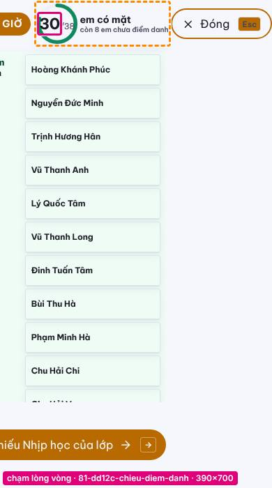

### `82-dd12c-chieu-nhip-lop` — Thầy · `?man=gv-nhip&ht2=1&dd12c=1` · thao tác `dd12c:nhip`

| Loại | Phần tử | Mẫu chữ | Đo | Khổ bị | Ghi |
|---|---|---|---:|---|---|
| a | `div.ddv-ba-cot>section.ddv-cot>ol.ddv-cot-ds` | 11 | 12 | 390×700, 360×640, 412×780, 390×844, 844×390 |  |
| a | `div.ca-chieu.cm` | Nhịp học · 12 Nhóm 10 điểm | 330 | 390×700, 360×640, 412×780, 390×844 |  |
| a | `div.ddv-tong>div.ddv-tong-thanh>span` | % | 12 | 390×700, 412×780, 390×844, 740×360 |  |
| a | `div.ddv-tong>div.ddv-tong-thanh>span` | 42 | 12 | 360×640, 740×360 |  |
| a | `div.ddv-ba-cot>section.ddv-cot>ol.ddv-cot-ds` | bỏ | 11 | 360×640, 844×390 |  |
| a | `div.ddv-man>header.ddv-dau>h1.ddv-lop` | Từ 01/10 đến 11/10 · 11 ngày đã qua | 179 | 844×390, 740×360 | ba chấm 1 dòng |
| a | `div.ca-chieu.cm` | Sang Gọi lên bảng đầu giờ | 169 | 844×390, 740×360 |  |
| a | `div.ddv-ba-cot>section.ddv-cot>ol.ddv-cot-ds` | / | 3 | 360×640 |  |
| a | `main.ddv-nhip>div.ddv-ba-cot>section.ddv-cot` | Chưa tải được: lệnh lạ (trang chụp) | 15 | 740×360 |  |
| c | `div.ddv-so-to>p>b ⟷ div.ddv-so-to>p>small` | 24 ⟷ em đủ mức hôm qua | 6 | 844×390, 740×360, 1024×768, 1440×900 |  |
| c | `div.ddv-so-to>p>b ⟷ div.ddv-so-to>p>small` | 1 ⟷ em đã đủ mức hôm n | 6 | 844×390, 740×360, 1024×768, 1440×900 |  |
| g | `div.ddv-ba-cot>section.ddv-cot>p.ddv-treo-khong` | Chưa tải được: lệnh lạ (trang chụp) | 4 | 390×700, 412×780, 390×844 | 4 dòng, rộng 45px |
| b | `div.ddv-tong>div.ddv-so-to>p ∋ b` | 24 | 3 | 1024×768 |  |
| h | `trang` | trang rộng hơn khung 585px | 614 | 390×700, 360×640, 412×780, 390×844, 844×390, 740×360 |  |

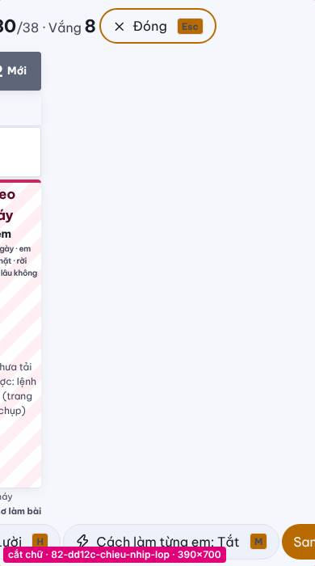

### `82-dd12c-chieu-nhip-lop-an-luoi` — Thầy · `?man=gv-nhip&ht2=1&dd12c=1` · thao tác `dd12c:nhip:h`

| Loại | Phần tử | Mẫu chữ | Đo | Khổ bị | Ghi |
|---|---|---|---:|---|---|
| a | `div.ddv-ba-cot>section.ddv-cot>ol.ddv-cot-ds` | 11 | 12 | 390×700, 360×640, 412×780, 390×844, 844×390 |  |
| a | `div.ca-chieu.cm` | Nhịp học · 12 Nhóm 10 điểm | 330 | 390×700, 360×640, 412×780, 390×844 |  |
| a | `div.ddv-tong>div.ddv-tong-thanh>span` | % | 12 | 390×700, 412×780, 390×844, 740×360 |  |
| a | `div.ddv-tong>div.ddv-tong-thanh>span` | 42 | 12 | 360×640, 740×360 |  |
| a | `div.ddv-ba-cot>section.ddv-cot>ol.ddv-cot-ds` | bỏ | 11 | 360×640, 844×390 |  |
| a | `div.ddv-man>header.ddv-dau>h1.ddv-lop` | Từ 01/10 đến 11/10 · 11 ngày đã qua | 179 | 844×390, 740×360 | ba chấm 1 dòng |
| a | `div.ca-chieu.cm` | Sang Gọi lên bảng đầu giờ | 169 | 844×390, 740×360 |  |
| a | `div.ddv-ba-cot>section.ddv-cot>ol.ddv-cot-ds` | / | 3 | 360×640 |  |
| a | `main.ddv-nhip>div.ddv-ba-cot>section.ddv-cot` | Chưa tải được: lệnh lạ (trang chụp) | 15 | 740×360 |  |
| c | `div.ddv-so-to>p>b ⟷ div.ddv-so-to>p>small` | 24 ⟷ em đủ mức hôm qua | 6 | 844×390, 740×360, 1024×768, 1440×900 |  |
| c | `div.ddv-so-to>p>b ⟷ div.ddv-so-to>p>small` | 1 ⟷ em đã đủ mức hôm n | 6 | 844×390, 740×360, 1024×768, 1440×900 |  |
| g | `div.ddv-ba-cot>section.ddv-cot>p.ddv-treo-khong` | Chưa tải được: lệnh lạ (trang chụp) | 4 | 390×700, 412×780, 390×844 | 4 dòng, rộng 45px |
| b | `div.ddv-tong>div.ddv-so-to>p ∋ b` | 24 | 3 | 1024×768 |  |
| h | `trang` | trang rộng hơn khung 585px | 614 | 390×700, 360×640, 412×780, 390×844, 844×390, 740×360 |  |

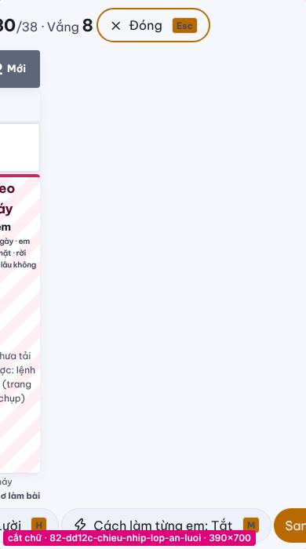

### `83-dd12c-chieu-ho-so-em` — Thầy · `?man=gv-nhip&ht2=1&dd12c=1` · thao tác `dd12c:ho-so`

| Loại | Phần tử | Mẫu chữ | Đo | Khổ bị | Ghi |
|---|---|---|---:|---|---|
| a | `div.ddv-ba-cot>section.ddv-cot>ol.ddv-cot-ds` | 11 | 12 | 390×700, 360×640, 412×780, 390×844, 844×390 |  |
| a | `div.ca-chieu.cm` | Nhịp học · 12 Nhóm 10 điểm | 330 | 390×700, 360×640, 412×780, 390×844 |  |
| a | `div.ddv-tong>div.ddv-tong-thanh>span` | % | 12 | 390×700, 412×780, 390×844, 740×360 |  |
| a | `div.ddv-tong>div.ddv-tong-thanh>span` | 42 | 12 | 360×640, 740×360 |  |
| a | `div.ddv-ba-cot>section.ddv-cot>ol.ddv-cot-ds` | bỏ | 11 | 360×640, 844×390 |  |
| a | `div.ddv-man>header.ddv-dau>h1.ddv-lop` | Từ 01/10 đến 11/10 · 11 ngày đã qua | 179 | 844×390, 740×360 | ba chấm 1 dòng |
| a | `div.ca-chieu.cm` | Sang Gọi lên bảng đầu giờ | 169 | 844×390, 740×360 |  |
| a | `div.ddv-ba-cot>section.ddv-cot>ol.ddv-cot-ds` | / | 3 | 360×640 |  |
| a | `main.ddv-nhip>div.ddv-ba-cot>section.ddv-cot` | Chưa tải được: lệnh lạ (trang chụp) | 15 | 740×360 |  |
| c | `div.ddv-so-to>p>b ⟷ div.ddv-so-to>p>small` | 24 ⟷ em đủ mức hôm qua | 6 | 844×390, 740×360, 1024×768, 1440×900 |  |
| c | `div.ddv-so-to>p>b ⟷ div.ddv-so-to>p>small` | 1 ⟷ em đã đủ mức hôm n | 6 | 844×390, 740×360, 1024×768, 1440×900 |  |
| g | `div.ddv-ba-cot>section.ddv-cot>p.ddv-treo-khong` | Chưa tải được: lệnh lạ (trang chụp) | 4 | 390×700, 412×780, 390×844 | 4 dòng, rộng 45px |
| b | `div.ddv-tong>div.ddv-so-to>p ∋ b` | 24 | 3 | 1024×768 |  |
| h | `trang` | trang rộng hơn khung 585px | 614 | 390×700, 360×640, 412×780, 390×844, 844×390, 740×360 |  |

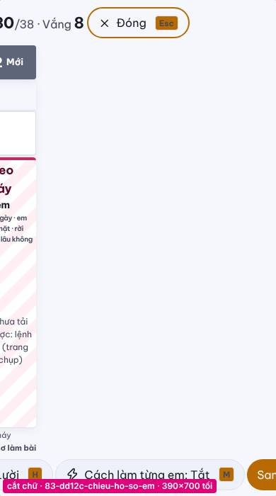

### `hs-menu-mo` — Học sinh · `?man=hs-menu` · thao tác `nut:Mở menu`

| Loại | Phần tử | Mẫu chữ | Đo | Khổ bị | Ghi |
|---|---|---|---:|---|---|
| d | `div.ht-shell>div.ht-app.ht2>nav.tr-menu che button.mot-dong>b.mot-so-phai>small` |  bài | 0 | 412×780, 390×844, 844×390, 1024×768, 1440×900 | fixed |
| d | `div.ht-shell>div.ht-app.ht2>nav.tr-menu che section.mot-sau>div.mot-ds>button.mot-dong` | 2Bài tập về nhàThầy đang giao1 bài | 0 | 412×780, 390×844, 844×390, 1024×768, 1440×900 | fixed |
| d | `div.ht-shell>div.ht-app.ht2>nav.tr-menu che button.mot-dong>span.mot-giua>strong` | Bài tập về nhà | 0 | 412×780, 390×844, 844×390, 1024×768 | fixed |
| d | `div.ht-shell>div.ht-app.ht2>nav.tr-menu che button.mot-dong>span.mot-giua>small` | Thầy đang giao | 0 | 412×780, 390×844, 844×390, 1024×768 | fixed |
| d | `div.ht-shell>div.ht-app.ht2>nav.tr-menu che div.mot-ds>button.mot-dong>b.mot-so-phai` | 1 | 0 | 412×780, 390×844, 844×390, 1024×768 | fixed |
| d | `div.ht-shell>div.ht-app.ht2>nav.tr-menu che div.mot-than>div.mot-chu>p.mot-nho` | Học tiếp | 0 | 412×780, 390×844, 844×390 | fixed |
| d | `div.ht-shell>div.ht-app.ht2>nav.tr-menu che div.mot-than>div.mot-chu>h2` | Hành trình giỏi hoá · Khối 12 | 0 | 412×780, 390×844, 844×390 | fixed |
| d | `div.ht-shell>div.ht-app.ht2>nav.tr-menu che div.mot-than>div.mot-chu>p.mot-phu` | Hiểu · Chặng 4/5 | 0 | 412×780, 390×844, 844×390 | fixed |
| d | `div.ht-shell>div.ht-app.ht2>nav.tr-menu che div.mot-luoi>section.mot-viec>button.mot-nut` | Học tiếp · 12 câu | 0 | 412×780, 390×844, 844×390 | fixed |
| d | `div.ht-shell>div.ht-app.ht2>nav.tr-menu che section.mot-viec>div.mot-chan>span.tr-chip` |  câu để đủ mức | 0 | 412×780, 390×844, 844×390 | fixed |
| d | `div.ht-shell>div.ht-app.ht2>nav.tr-menu che div.mot-ds>button.mot-dong>span.mot-so` | 2 | 0 | 844×390 | fixed |

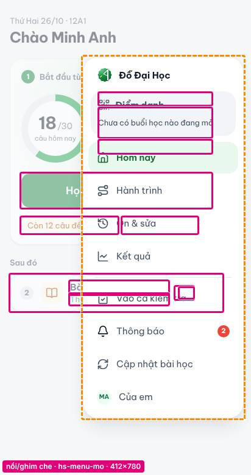

### `52-ttc-to-chieu` — Thầy · `?man=gv-nhip&the=can-chua&ttc=1` · thao tác `ttc-chieu:DH-12-C2-B6`

| Loại | Phần tử | Mẫu chữ | Đo | Khổ bị | Ghi |
|---|---|---|---:|---|---|
| a | `div.mc-thanh>span.mc-tc-lop-sai` | 8/30 em lớp sai câu này | 128 | 844×390 | ba chấm 1 dòng · tờ chiếu |
| h | `div.mc-thanh>div.mc-phim-nhom>button.mc-nut-phim` | TThống kê | 28 | 390×700, 412×780, 390×844 | tờ chiếu |
| h | `div.mc-phim-nhom>button.mc-nut-phim>span.mc-nut-chu` | Giải | 9 | 360×640 | tờ chiếu |
| h | `div.mc-thanh>div.mc-phim-nhom>button.mc-nut-phim` | GGiải | 20 | 360×640 | tờ chiếu |
| h | `div.mc-thanh>span.mc-tc-lop-sai` | 8/30 em lớp sai câu này | 30 | 844×390 | tờ chiếu |
| h | `div.mc-thanh>button` | Cài đặt | 43 | 740×360 | tờ chiếu |
| f | `div.gvv2-ttc-than>div.gvv2-ttc-cuoi>span.gvv2-ttc-goi-y` | ·  | 0 | 390×700, 390×844 |  |

### `52-ttc-to-chieu-thong-ke` — Thầy · `?man=gv-nhip&the=can-chua&ttc=1` · thao tác `ttc-chieu:DH-12-C2-B6:t`

| Loại | Phần tử | Mẫu chữ | Đo | Khổ bị | Ghi |
|---|---|---|---:|---|---|
| a | `div.mc-thanh>span.mc-tc-lop-sai` | 6/25 em lớp sai câu này | 123 | 844×390 | ba chấm 1 dòng · tờ chiếu |
| h | `div.mc-thanh>div.mc-phim-nhom>button.mc-nut-phim.mc-bat` | TThống kê | 28 | 390×700, 412×780, 390×844 | tờ chiếu |
| h | `div.mc-phim-nhom>button.mc-nut-phim>span.mc-nut-chu` | Giải | 9 | 360×640 | tờ chiếu |
| h | `div.mc-thanh>div.mc-phim-nhom>button.mc-nut-phim` | GGiải | 20 | 360×640 | tờ chiếu |
| h | `div.mc-thanh>span.mc-tc-lop-sai` | 6/25 em lớp sai câu này | 25 | 844×390 | tờ chiếu |
| h | `div.mc-thanh>button` | Cài đặt | 43 | 740×360 | tờ chiếu |
| f | `div.gvv2-ttc-than>div.gvv2-ttc-cuoi>span.gvv2-ttc-goi-y` | ·  | 0 | 390×700, 390×844 |  |

### `52-ttc-to-chieu-dot-5` — Thầy · `?man=gv-nhip&the=can-chua&ttc=1` · thao tác `ttc-chieu:DH-12-C2-B6:→→→→t`

| Loại | Phần tử | Mẫu chữ | Đo | Khổ bị | Ghi |
|---|---|---|---:|---|---|
| a | `div.mc-thanh>span.mc-tc-lop-sai` | 8/29 em lớp sai câu này | 123 | 844×390 | ba chấm 1 dòng · tờ chiếu |
| h | `div.mc-thanh>div.mc-phim-nhom>button.mc-nut-phim.mc-bat` | TThống kê | 28 | 390×700, 412×780, 390×844 | tờ chiếu |
| h | `div.mc-phim-nhom>button.mc-nut-phim>span.mc-nut-chu` | Giải | 9 | 360×640 | tờ chiếu |
| h | `div.mc-thanh>div.mc-phim-nhom>button.mc-nut-phim` | GGiải | 20 | 360×640 | tờ chiếu |
| h | `div.mc-thanh>span.mc-tc-lop-sai` | 8/29 em lớp sai câu này | 25 | 844×390 | tờ chiếu |
| h | `div.mc-thanh>button` | Cài đặt | 43 | 740×360 | tờ chiếu |
| f | `div.gvv2-ttc-than>div.gvv2-ttc-cuoi>span.gvv2-ttc-goi-y` | ·  | 0 | 390×700, 390×844 |  |

### `52-ttc-to-chieu-loi-giai` — Thầy · `?man=gv-nhip&the=can-chua&ttc=1` · thao tác `ttc-chieu:DH-12-C2-B6:g `

| Loại | Phần tử | Mẫu chữ | Đo | Khổ bị | Ghi |
|---|---|---|---:|---|---|
| a | `div.mc-thanh>span.mc-tc-lop-sai` | 8/30 em lớp sai câu này | 142 | 844×390 | ba chấm 1 dòng · tờ chiếu |
| h | `div.mc-thanh>div.mc-phim-nhom>button.mc-nut-phim.mc-bat` | GẨn giải | 39 | 390×700, 360×640, 390×844 | tờ chiếu |
| h | `div.mc-phim-nhom>button.mc-nut-phim.mc-bat>span.mc-nut-chu` | Ẩn giải | 28 | 360×640 | tờ chiếu |
| h | `div.mc-thanh>div.mc-phim-nhom>button.mc-nut-phim` | TThống kê | 26 | 412×780 | tờ chiếu |
| h | `div.mc-thanh>span.mc-tc-lop-sai` | 8/30 em lớp sai câu này | 45 | 844×390 | tờ chiếu |
| f | `div.gvv2-ttc-than>div.gvv2-ttc-cuoi>span.gvv2-ttc-goi-y` | ·  | 0 | 390×700, 390×844 |  |

### `43-hs12-tu-luyen-lam` — Học sinh · `?man=hs12-tu-luyen-lam`

| Loại | Phần tử | Mẫu chữ | Đo | Khổ bị | Ghi |
|---|---|---|---:|---|---|
| c | `div.osl>span.osl-cum>button.osl-nut.osl-nut-dau ⟷ div>div.osl>input.tap-target` | Đáp án của em ⟷ Đổi dấu âm | 44 | mọi khổ |  |
| c | `div.osl>span.osl-cum>button.osl-nut.osl-nut-phay ⟷ div>div.osl>input.tap-target` | Đáp án của em ⟷ Thêm dấu phẩy | 44 | mọi khổ |  |

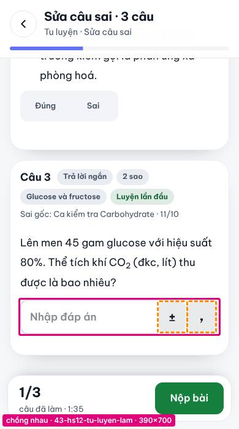

### `85-dd12c-muc-lam` — Thầy · `?man=gv-nhip&ht2=1&dd12c=1&mlo=1` · thao tác `dd12c:muc`

| Loại | Phần tử | Mẫu chữ | Đo | Khổ bị | Ghi |
|---|---|---|---:|---|---|
| c | `button.dd1-vua-dong>span.dd1-ov>b ⟷ button.dd1-vua-dong>span.dd1-ov>small` | 20 ⟷ lượt sai | 3 | 390×700, 360×640, 412×780, 390×844 |  |
| c | `button.dd1-vua-dong>span.dd1-ov>b ⟷ button.dd1-vua-dong>span.dd1-ov>small` | 38 ⟷ 6 | 3 | 390×700, 360×640, 390×844 |  |
| j | `div.dd1-o.dd1-o--vua>div.dd1-tong>div.dd1-tong-nuts` | Cố tình treo máy4 | 400 | 740×360, 1024×768, 1440×900 | 3+1 ô |

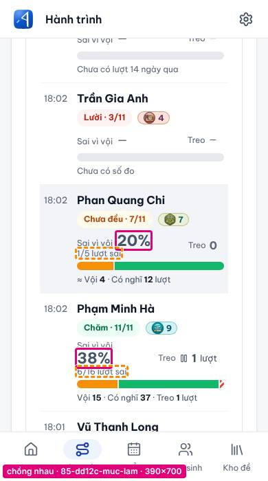

### `87-dd12c-loc-treo` — Thầy · `?man=gv-nhip&ht2=1&dd12c=1&mlo=1` · thao tác `dd12c:muc-treo`

| Loại | Phần tử | Mẫu chữ | Đo | Khổ bị | Ghi |
|---|---|---|---:|---|---|
| c | `button.dd1-vua-dong>span.dd1-ov>b ⟷ button.dd1-vua-dong>span.dd1-ov>small` | 38 ⟷ 6 | 3 | 390×700, 360×640, 390×844 |  |
| c | `button.dd1-vua-dong>span.dd1-ov>b ⟷ button.dd1-vua-dong>span.dd1-ov>small` | 38 ⟷ lượt sai | 3 | 412×780 |  |
| j | `div.dd1-o.dd1-o--vua>div.dd1-tong>div.dd1-tong-nuts` | Cố tình treo máy4 | 400 | 740×360, 1024×768, 1440×900 | 3+1 ô |

### `86-dd12c-ngay-dau` — Thầy · `?man=gv-nhip&ht2=1&dd12c=1&mlo=dau` · thao tác `dd12c:muc`

| Loại | Phần tử | Mẫu chữ | Đo | Khổ bị | Ghi |
|---|---|---|---:|---|---|
| c | `button.dd1-vua-dong>span.dd1-ov>b ⟷ button.dd1-vua-dong>span.dd1-ov>small` | 20 ⟷ lượt sai | 3 | 390×700, 360×640, 412×780, 390×844 |  |

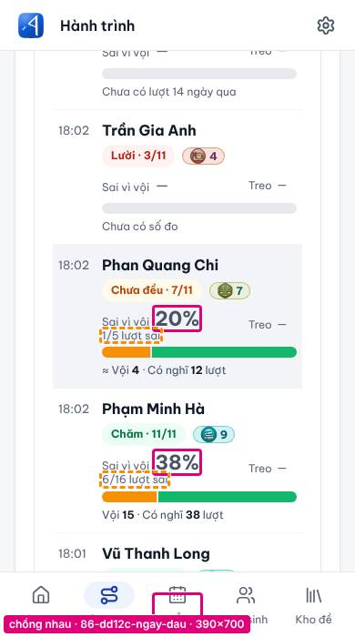

### `30-hs-moi-ca-mo` — Học sinh · `?man=hs-moi&ca=1`

| Loại | Phần tử | Mẫu chữ | Đo | Khổ bị | Ghi |
|---|---|---|---:|---|---|
| g | `button.mot-dong>span.mot-giua>strong` | Hành trình giỏi hoá · Khối 12 | 4 | 360×640 | 4 dòng, rộng 73px |

### `soat-kiem-tra-on-tap-lam-chang` — Học sinh · `?man=soat-ktcn` · thao tác `nut:Làm tiếp chặng 2`

| Loại | Phần tử | Mẫu chữ | Đo | Khổ bị | Ghi |
|---|---|---|---:|---|---|
| j | `div.ktcn-lam>main.ktcn-noi>div.ktcn-nav.ktcn-nav-dt` | 7 | 332 | 390×700, 360×640, 412×780, 390×844 | 6+1 ô |
| j | `div.ktcn-lam>aside.ktcn-ben>div.ktcn-nav` | 7 | 268 | 844×390, 740×360, 1024×768, 1440×900 | 3+3+1 ô |

### `hs-menu-ca-mo` — Học sinh · `?man=hs-menu&ca=1`

| Loại | Phần tử | Mẫu chữ | Đo | Khổ bị | Ghi |
|---|---|---|---:|---|---|
| f | `button.mot-dong>span.mot-giua>strong` | · Khối 12 | 0 | 390×700, 390×844 |  |

### `51-ttc-chon-de` — Thầy · `?man=gv-nhip&the=can-chua&ttc=1` · thao tác `ttc:DH-12-C2-B6`

| Loại | Phần tử | Mẫu chữ | Đo | Khổ bị | Ghi |
|---|---|---|---:|---|---|
| f | `div.gvv2-ttc-than>div.gvv2-ttc-cuoi>span.gvv2-ttc-goi-y` | ·  | 0 | 390×700, 390×844 |  |

### `52-ttc-to-chieu-ai-sai` — Thầy · `?man=gv-nhip&the=can-chua&ttc=1` · thao tác `ttc-chieu:DH-12-C2-B6:x`

| Loại | Phần tử | Mẫu chữ | Đo | Khổ bị | Ghi |
|---|---|---|---:|---|---|
| f | `div.gvv2-ttc-than>div.gvv2-ttc-cuoi>span.gvv2-ttc-goi-y` | ·  | 0 | 390×700, 390×844 |  |

### `60-cb-chua-bai` — Thầy · `?man=gv-nhip&the=can-chua&ttc=1&cb=1` · thao tác `cb:DH-12-C2-B6`

| Loại | Phần tử | Mẫu chữ | Đo | Khổ bị | Ghi |
|---|---|---|---:|---|---|
| f | `div.gvv2-ttc-than>div.gvv2-ttc-cuoi>span.gvv2-ttc-goi-y` | ·  | 0 | 390×700, 390×844 |  |

### `61-cb-to-chieu-cho-goi` — Thầy · `?man=gv-nhip&the=can-chua&ttc=1&cb=1` · thao tác `cb-chieu:DH-12-C2-B6`

| Loại | Phần tử | Mẫu chữ | Đo | Khổ bị | Ghi |
|---|---|---|---:|---|---|
| f | `div.gvv2-ttc-than>div.gvv2-ttc-cuoi>span.gvv2-ttc-goi-y` | ·  | 0 | 390×700, 390×844 |  |

### `61-cb-to-chieu-da-goi` — Thầy · `?man=gv-nhip&the=can-chua&ttc=1&cb=1` · thao tác `cb-chieu:DH-12-C2-B6:l`

| Loại | Phần tử | Mẫu chữ | Đo | Khổ bị | Ghi |
|---|---|---|---:|---|---|
| f | `div.gvv2-ttc-than>div.gvv2-ttc-cuoi>span.gvv2-ttc-goi-y` | ·  | 0 | 390×700, 390×844 |  |

### `61-cb-to-chieu-goi-em-khac` — Thầy · `?man=gv-nhip&the=can-chua&ttc=1&cb=1` · thao tác `cb-chieu:DH-12-C2-B6:le`

| Loại | Phần tử | Mẫu chữ | Đo | Khổ bị | Ghi |
|---|---|---|---:|---|---|
| f | `div.gvv2-ttc-than>div.gvv2-ttc-cuoi>span.gvv2-ttc-goi-y` | ·  | 0 | 390×700, 390×844 |  |

### `61-cb-to-chieu-da-goi-loi-giai` — Thầy · `?man=gv-nhip&the=can-chua&ttc=1&cb=1` · thao tác `cb-chieu:DH-12-C2-B6:lg `

| Loại | Phần tử | Mẫu chữ | Đo | Khổ bị | Ghi |
|---|---|---|---:|---|---|
| f | `div.gvv2-ttc-than>div.gvv2-ttc-cuoi>span.gvv2-ttc-goi-y` | ·  | 0 | 390×700, 390×844 |  |

### `42-hs12-tu-chua` — Học sinh · `?man=hs12-tu-chua`

| Loại | Phần tử | Mẫu chữ | Đo | Khổ bị | Ghi |
|---|---|---|---:|---|---|
| f | `button.tcl-the>span.tcl-the-chu>small.tcl-the-phu` | · Ôn theo kế hoạch | 0 | 412×780 |  |

### `hs-mot-thuong` — Học sinh · `?man=hs-mot`

| Loại | Phần tử | Mẫu chữ | Đo | Khổ bị | Ghi |
|---|---|---|---:|---|---|
| f | `button.mot-dong>span.mot-giua>small` | · hạn nộp 24:00 | 0 | 740×360 |  |

### `hs-mot-ca-mo` — Học sinh · `?man=hs-mot&tt=ca`

| Loại | Phần tử | Mẫu chữ | Đo | Khổ bị | Ghi |
|---|---|---|---:|---|---|
| f | `button.mot-dong>span.mot-giua>small` | · hạn nộp 24:00 | 0 | 740×360 |  |

### `hs-mot-khong-buoi` — Học sinh · `?man=hs-mot&dd=khong`

| Loại | Phần tử | Mẫu chữ | Đo | Khổ bị | Ghi |
|---|---|---|---:|---|---|
| f | `button.mot-dong>span.mot-giua>small` | · hạn nộp 24:00 | 0 | 740×360 |  |

### `25-hs-cau-da-lam` — Học sinh · `?man=cau-da-lam`

| Loại | Phần tử | Mẫu chữ | Đo | Khổ bị | Ghi |
|---|---|---|---:|---|---|
| j | `div.h2-cdl-ng-than>aside.h2-cdl-ng-trai>div.tl-hang.tl-hang--mot-dong` | Cần thầy dạy lại 6 | 394 | 1440×900 | 4+1 ô |

### `ng-hoc-sinh` — Thầy · `?man=gv-hoc-sinh`

| Loại | Phần tử | Mẫu chữ | Đo | Khổ bị | Ghi |
|---|---|---|---:|---|---|
| j | `div.gv-page.gvhs>section.gvv2-the.gvhs-the>div.gvhs-loc` |  | 865 | 1024×768 (chỉ tối) | 4+1 ô |

## Đích bấm < 44px (i) — theo màn

| Màn | Số nút (gộp) | Nhỏ nhất | Ví dụ |
|---|---:|---:|---|
| `52-ttc-to-chieu-thong-ke` | 7 | 34px | «Đóng» 34×34 · «Đợt trước» 32×32 · «Lên bảng» 58×32 |
| `52-ttc-to-chieu-loi-giai` | 7 | 34px | «Đóng» 34×34 · «Đợt trước» 32×32 · «Lên bảng» 58×32 |
| `52-ttc-to-chieu-dot-5` | 7 | 34px | «Đóng» 34×34 · «Đợt trước» 32×32 · «Lên bảng» 58×32 |
| `52-ttc-to-chieu` | 6 | 34px | «Đóng» 34×34 · «Đợt trước» 32×32 · «Lên bảng» 58×32 |
| `52-ttc-to-chieu-ai-sai` | 3 | 34px | «Đóng» 34×34 · «11B · 30 em12 - Tinh Hoa» 240×40 · «Bài 1. EsterBài 2. Lipid» 591×40 |
| `ng-hoc-sinh` | 2 | 40px | «INPUT» 220×40 · «Lọc theo khối» 88×40 |
| `ng-cai-dat` | 2 | 40px | «INPUT» 369×40 · «INPUT» 646×40 |
| `50-ttc-the-gap` | 2 | 40px | «11B · 30 em12 - Tinh Hoa» 240×40 · «Chọn bài cần chữaBài 3. » 591×40 |
| `51-ttc-chon-de` | 2 | 40px | «11B · 30 em12 - Tinh Hoa» 240×40 · «Bài 1. EsterBài 2. Lipid» 591×40 |
| `60-cb-chua-bai` | 2 | 40px | «11B · 30 em12 - Tinh Hoa» 240×40 · «Bài 1. EsterBài 2. Lipid» 591×40 |
| `61-cb-to-chieu-cho-goi` | 2 | 40px | «11B · 30 em12 - Tinh Hoa» 240×40 · «Bài 1. EsterBài 2. Lipid» 591×40 |
| `61-cb-to-chieu-da-goi` | 2 | 40px | «11B · 30 em12 - Tinh Hoa» 240×40 · «Bài 1. EsterBài 2. Lipid» 591×40 |
| `61-cb-to-chieu-goi-em-khac` | 2 | 40px | «11B · 30 em12 - Tinh Hoa» 240×40 · «Bài 1. EsterBài 2. Lipid» 591×40 |
| `61-cb-to-chieu-da-goi-loi-giai` | 2 | 40px | «11B · 30 em12 - Tinh Hoa» 240×40 · «Bài 1. EsterBài 2. Lipid» 591×40 |
| `14-gv-can-chua` | 2 | 40px | «11B · 30 em12A1 · 44 em» 240×40 · «Chọn bài cần chữaBài 3. » 591×40 |
| `14-gv-can-chua-loc-khoi-12` | 2 | 40px | «11B · 30 em12A1 · 44 em» 240×40 · «Chọn bài cần chữaBài 3. » 591×40 |
| `82-dd12c-chieu-nhip-lop` | 1 | 43px | «Bùi Thu Hà, Chăm, đủ mức» 43×118 |
| `82-dd12c-chieu-nhip-lop-an-luoi` | 1 | 43px | «Bùi Thu Hà, Chăm, đủ mức» 43×118 |
| `83-dd12c-chieu-ho-so-em` | 1 | 43px | «Bùi Thu Hà, Chăm, đủ mức» 43×118 |

## Nhóm riêng: ba chấm «…» cố ý ở dòng danh sách (a…)

Không tính là lỗi; liệt kê để thầy/Boss xem có chỗ nào cần hiện đủ (xem đủ được khi bấm theo chuẩn B14).

| Màn | Phần tử | Mẫu chữ | Px bị ẩn | Khổ |
|---|---|---|---:|---|
| `hs-tam-khac-phuc` | `div>div>span.truncate` | Kiểm tra tuần 11 · Amino acid và peptide | 161 | 390×700, 360×640, 412×780, 390×844 |
| `hs-tam-khac-phuc` | `div>div>span.truncate` | Kiểm tra tuần 12 · Polymer | 76 | 390×700, 360×640, 412×780, 390×844 |
| `hs-tam-khac-phuc` | `div>div>span.truncate` | Kiểm tra tuần 10 · Amine | 57 | 390×700, 360×640, 412×780, 390×844 |
| `51-ttc-chon-de` | `li.gvv2-ttc-dong>div.gvv2-ttc-cau>span.gvv2-ttc-de` | Cho 8,1 gam cellulose phản ứng với nitri | 36 | 390×700, 360×640, 412×780, 390×844, 740×360 |
| `52-ttc-to-chieu` | `li.gvv2-ttc-dong>div.gvv2-ttc-cau>span.gvv2-ttc-de` | Cho 8,1 gam cellulose phản ứng với nitri | 36 | 390×700, 360×640, 412×780, 390×844, 740×360 |
| `52-ttc-to-chieu-thong-ke` | `li.gvv2-ttc-dong>div.gvv2-ttc-cau>span.gvv2-ttc-de` | Cho 8,1 gam cellulose phản ứng với nitri | 36 | 390×700, 360×640, 412×780, 390×844, 740×360 |
| `52-ttc-to-chieu-loi-giai` | `li.gvv2-ttc-dong>div.gvv2-ttc-cau>span.gvv2-ttc-de` | Cho 8,1 gam cellulose phản ứng với nitri | 36 | 390×700, 360×640, 412×780, 390×844, 740×360 |
| `52-ttc-to-chieu-ai-sai` | `li.gvv2-ttc-dong>div.gvv2-ttc-cau>span.gvv2-ttc-de` | Cho 8,1 gam cellulose phản ứng với nitri | 36 | 390×700, 360×640, 412×780, 390×844, 740×360 |
| `52-ttc-to-chieu-dot-5` | `li.gvv2-ttc-dong>div.gvv2-ttc-cau>span.gvv2-ttc-de` | Cho 8,1 gam cellulose phản ứng với nitri | 36 | 390×700, 360×640, 412×780, 390×844, 740×360 |
| `60-cb-chua-bai` | `li.gvv2-ttc-dong>div.gvv2-ttc-cau>span.gvv2-ttc-de` | Cho 8,1 gam cellulose phản ứng với nitri | 36 | 390×700, 360×640, 412×780, 390×844, 740×360 |
| `61-cb-to-chieu-cho-goi` | `li.gvv2-ttc-dong>div.gvv2-ttc-cau>span.gvv2-ttc-de` | Cho 8,1 gam cellulose phản ứng với nitri | 36 | 390×700, 360×640, 390×844, 740×360 |
| `61-cb-to-chieu-da-goi` | `li.gvv2-ttc-dong>div.gvv2-ttc-cau>span.gvv2-ttc-de` | Cho 8,1 gam cellulose phản ứng với nitri | 36 | 390×700, 360×640, 412×780, 390×844, 740×360 |
| `61-cb-to-chieu-goi-em-khac` | `li.gvv2-ttc-dong>div.gvv2-ttc-cau>span.gvv2-ttc-de` | Cho 8,1 gam cellulose phản ứng với nitri | 36 | 390×700, 360×640, 390×844, 740×360 |
| `61-cb-to-chieu-da-goi-loi-giai` | `li.gvv2-ttc-dong>div.gvv2-ttc-cau>span.gvv2-ttc-de` | Cho 8,1 gam cellulose phản ứng với nitri | 36 | 360×640, 412×780, 390×844, 740×360 |
| `51-ttc-chon-de` | `li.gvv2-ttc-dong>div.gvv2-ttc-cau>span.gvv2-ttc-de` | Thuỷ phân hoàn toàn 32,4 gam tinh bột tr | 17 | 390×700, 360×640, 412×780, 390×844, 740×360 |
| `51-ttc-chon-de` | `li.gvv2-ttc-dong>div.gvv2-ttc-cau>span.gvv2-ttc-de` | Một nhà máy dùng 1 tấn mùn cưa chứa 50%  | 17 | 390×700, 360×640, 412×780, 390×844, 740×360 |
| `51-ttc-chon-de` | `li.gvv2-ttc-dong>div.gvv2-ttc-cau>span.gvv2-ttc-de` | Lên men 360 gam glucose với hiệu suất 80 | 17 | 390×700, 360×640, 412×780, 390×844 |
| `51-ttc-chon-de` | `li.gvv2-ttc-dong>div.gvv2-ttc-cau>span.gvv2-ttc-de` | Cần bao nhiêu kg cellulose để sản xuất 2 | 17 | 390×700, 360×640, 412×780, 390×844, 740×360 |
| `51-ttc-chon-de` | `li.gvv2-ttc-dong>div.gvv2-ttc-cau>span.gvv2-ttc-de` | Từ 16,2 gam tinh bột điều chế ethanol vớ | 17 | 390×700, 360×640, 412×780, 390×844, 740×360 |
| `52-ttc-to-chieu` | `li.gvv2-ttc-dong>div.gvv2-ttc-cau>span.gvv2-ttc-de` | Cần bao nhiêu kg cellulose để sản xuất 2 | 17 | 390×700, 360×640, 412×780, 390×844, 740×360 |
| `52-ttc-to-chieu` | `li.gvv2-ttc-dong>div.gvv2-ttc-cau>span.gvv2-ttc-de` | Một nhà máy dùng 1 tấn mùn cưa chứa 50%  | 17 | 390×700, 360×640, 412×780, 390×844, 740×360 |
| `52-ttc-to-chieu` | `li.gvv2-ttc-dong>div.gvv2-ttc-cau>span.gvv2-ttc-de` | Thuỷ phân hoàn toàn 48,6 gam tinh bột rồ | 17 | 390×700, 360×640, 412×780, 390×844, 740×360 |
| `52-ttc-to-chieu` | `li.gvv2-ttc-dong>div.gvv2-ttc-cau>span.gvv2-ttc-de` | Từ 16,2 gam tinh bột điều chế ethanol vớ | 17 | 390×700, 360×640, 412×780, 390×844, 740×360 |
| `52-ttc-to-chieu` | `li.gvv2-ttc-dong>div.gvv2-ttc-cau>span.gvv2-ttc-de` | Lên men 360 gam glucose với hiệu suất 80 | 17 | 390×700, 360×640, 412×780, 390×844 |
| `52-ttc-to-chieu-thong-ke` | `li.gvv2-ttc-dong>div.gvv2-ttc-cau>span.gvv2-ttc-de` | Thuỷ phân hoàn toàn 32,4 gam tinh bột tr | 17 | 390×700, 360×640, 412×780, 390×844, 740×360 |
| `52-ttc-to-chieu-thong-ke` | `li.gvv2-ttc-dong>div.gvv2-ttc-cau>span.gvv2-ttc-de` | Lên men 360 gam glucose với hiệu suất 80 | 17 | 390×700, 360×640, 390×844 |
| `52-ttc-to-chieu-thong-ke` | `li.gvv2-ttc-dong>div.gvv2-ttc-cau>span.gvv2-ttc-de` | Một nhà máy dùng 1 tấn mùn cưa chứa 50%  | 17 | 390×700, 360×640, 412×780, 390×844, 740×360 |
| `52-ttc-to-chieu-thong-ke` | `li.gvv2-ttc-dong>div.gvv2-ttc-cau>span.gvv2-ttc-de` | Cần bao nhiêu kg cellulose để sản xuất 2 | 17 | 390×700, 360×640, 412×780, 390×844, 740×360 |
| `52-ttc-to-chieu-thong-ke` | `li.gvv2-ttc-dong>div.gvv2-ttc-cau>span.gvv2-ttc-de` | Từ 16,2 gam tinh bột điều chế ethanol vớ | 17 | 390×700, 360×640, 412×780, 390×844, 740×360 |
| `52-ttc-to-chieu-loi-giai` | `li.gvv2-ttc-dong>div.gvv2-ttc-cau>span.gvv2-ttc-de` | Thuỷ phân hoàn toàn 32,4 gam tinh bột tr | 17 | 390×700, 360×640, 412×780, 390×844, 740×360 |
| `52-ttc-to-chieu-loi-giai` | `li.gvv2-ttc-dong>div.gvv2-ttc-cau>span.gvv2-ttc-de` | Một nhà máy dùng 1 tấn mùn cưa chứa 50%  | 17 | 390×700, 360×640, 412×780, 390×844, 740×360 |
| `52-ttc-to-chieu-loi-giai` | `li.gvv2-ttc-dong>div.gvv2-ttc-cau>span.gvv2-ttc-de` | Lên men 360 gam glucose với hiệu suất 80 | 17 | 390×700, 360×640, 412×780, 390×844 |
| `52-ttc-to-chieu-loi-giai` | `li.gvv2-ttc-dong>div.gvv2-ttc-cau>span.gvv2-ttc-de` | Từ 16,2 gam tinh bột điều chế ethanol vớ | 17 | 390×700, 360×640, 412×780, 390×844, 740×360 |
| `52-ttc-to-chieu-loi-giai` | `li.gvv2-ttc-dong>div.gvv2-ttc-cau>span.gvv2-ttc-de` | Cần bao nhiêu kg cellulose để sản xuất 2 | 17 | 390×700, 360×640, 412×780, 390×844, 740×360 |
| `52-ttc-to-chieu-ai-sai` | `li.gvv2-ttc-dong>div.gvv2-ttc-cau>span.gvv2-ttc-de` | Thuỷ phân hoàn toàn 32,4 gam tinh bột tr | 17 | 390×700, 360×640, 412×780, 390×844, 740×360 |
| `52-ttc-to-chieu-ai-sai` | `li.gvv2-ttc-dong>div.gvv2-ttc-cau>span.gvv2-ttc-de` | Cần bao nhiêu kg cellulose để sản xuất 2 | 17 | 390×700, 360×640, 412×780, 390×844, 740×360 |
| `52-ttc-to-chieu-ai-sai` | `li.gvv2-ttc-dong>div.gvv2-ttc-cau>span.gvv2-ttc-de` | Một nhà máy dùng 1 tấn mùn cưa chứa 50%  | 17 | 390×700, 360×640, 412×780, 390×844, 740×360 |
| `52-ttc-to-chieu-ai-sai` | `li.gvv2-ttc-dong>div.gvv2-ttc-cau>span.gvv2-ttc-de` | Lên men 360 gam glucose với hiệu suất 80 | 17 | 390×700, 360×640, 412×780, 390×844 |
| `52-ttc-to-chieu-ai-sai` | `li.gvv2-ttc-dong>div.gvv2-ttc-cau>span.gvv2-ttc-de` | Từ 16,2 gam tinh bột điều chế ethanol vớ | 17 | 390×700, 360×640, 412×780, 390×844, 740×360 |
| `52-ttc-to-chieu-dot-5` | `li.gvv2-ttc-dong>div.gvv2-ttc-cau>span.gvv2-ttc-de` | Thuỷ phân hoàn toàn 48,6 gam tinh bột rồ | 17 | 390×700, 360×640, 412×780, 390×844, 740×360 |
| `52-ttc-to-chieu-dot-5` | `li.gvv2-ttc-dong>div.gvv2-ttc-cau>span.gvv2-ttc-de` | Cần bao nhiêu kg cellulose để sản xuất 2 | 17 | 390×700, 360×640, 412×780, 390×844, 740×360 |
| `52-ttc-to-chieu-dot-5` | `li.gvv2-ttc-dong>div.gvv2-ttc-cau>span.gvv2-ttc-de` | Một nhà máy dùng 1 tấn mùn cưa chứa 50%  | 17 | 390×700, 412×780, 390×844, 740×360 |
| `52-ttc-to-chieu-dot-5` | `li.gvv2-ttc-dong>div.gvv2-ttc-cau>span.gvv2-ttc-de` | Từ 16,2 gam tinh bột điều chế ethanol vớ | 17 | 390×700, 360×640, 412×780, 390×844, 740×360 |
| `52-ttc-to-chieu-dot-5` | `li.gvv2-ttc-dong>div.gvv2-ttc-cau>span.gvv2-ttc-de` | Lên men 360 gam glucose với hiệu suất 80 | 17 | 360×640, 412×780, 390×844 |
| `60-cb-chua-bai` | `li.gvv2-ttc-dong>div.gvv2-ttc-cau>span.gvv2-ttc-de` | Thuỷ phân hoàn toàn 48,6 gam tinh bột rồ | 17 | 390×700, 360×640, 412×780, 390×844, 740×360 |
| `60-cb-chua-bai` | `li.gvv2-ttc-dong>div.gvv2-ttc-cau>span.gvv2-ttc-de` | Cần bao nhiêu kg cellulose để sản xuất 2 | 17 | 390×700, 360×640, 412×780, 390×844, 740×360 |
| `60-cb-chua-bai` | `li.gvv2-ttc-dong>div.gvv2-ttc-cau>span.gvv2-ttc-de` | Một nhà máy dùng 1 tấn mùn cưa chứa 50%  | 17 | 390×700, 360×640, 390×844, 740×360 |
| `60-cb-chua-bai` | `li.gvv2-ttc-dong>div.gvv2-ttc-cau>span.gvv2-ttc-de` | Từ 16,2 gam tinh bột điều chế ethanol vớ | 17 | 390×700, 360×640, 412×780, 390×844, 740×360 |
| `60-cb-chua-bai` | `li.gvv2-ttc-dong>div.gvv2-ttc-cau>span.gvv2-ttc-de` | Lên men 360 gam glucose với hiệu suất 80 | 17 | 390×700, 360×640, 412×780, 390×844 |
| `61-cb-to-chieu-cho-goi` | `li.gvv2-ttc-dong>div.gvv2-ttc-cau>span.gvv2-ttc-de` | Thuỷ phân hoàn toàn 48,6 gam tinh bột rồ | 17 | 390×700, 360×640, 412×780, 390×844, 740×360 |
| `61-cb-to-chieu-cho-goi` | `li.gvv2-ttc-dong>div.gvv2-ttc-cau>span.gvv2-ttc-de` | Một nhà máy dùng 1 tấn mùn cưa chứa 50%  | 17 | 390×700, 360×640, 412×780, 390×844, 740×360 |
| `61-cb-to-chieu-cho-goi` | `li.gvv2-ttc-dong>div.gvv2-ttc-cau>span.gvv2-ttc-de` | Lên men 360 gam glucose với hiệu suất 80 | 17 | 390×700, 360×640, 412×780, 390×844 |
| `61-cb-to-chieu-cho-goi` | `li.gvv2-ttc-dong>div.gvv2-ttc-cau>span.gvv2-ttc-de` | Từ 16,2 gam tinh bột điều chế ethanol vớ | 17 | 390×700, 360×640, 412×780, 390×844, 740×360 |
| `61-cb-to-chieu-cho-goi` | `li.gvv2-ttc-dong>div.gvv2-ttc-cau>span.gvv2-ttc-de` | Cần bao nhiêu kg cellulose để sản xuất 2 | 17 | 360×640, 412×780, 390×844, 740×360 |
| `61-cb-to-chieu-da-goi` | `li.gvv2-ttc-dong>div.gvv2-ttc-cau>span.gvv2-ttc-de` | Thuỷ phân hoàn toàn 48,6 gam tinh bột rồ | 17 | 390×700, 360×640, 412×780, 390×844, 740×360 |
| `61-cb-to-chieu-da-goi` | `li.gvv2-ttc-dong>div.gvv2-ttc-cau>span.gvv2-ttc-de` | Cần bao nhiêu kg cellulose để sản xuất 2 | 17 | 390×700, 360×640, 412×780, 390×844, 740×360 |
| `61-cb-to-chieu-da-goi` | `li.gvv2-ttc-dong>div.gvv2-ttc-cau>span.gvv2-ttc-de` | Từ 16,2 gam tinh bột điều chế ethanol vớ | 17 | 390×700, 360×640, 412×780, 390×844, 740×360 |
| `61-cb-to-chieu-da-goi` | `li.gvv2-ttc-dong>div.gvv2-ttc-cau>span.gvv2-ttc-de` | Một nhà máy dùng 1 tấn mùn cưa chứa 50%  | 17 | 390×700, 360×640, 412×780, 390×844, 740×360 |
| `61-cb-to-chieu-da-goi` | `li.gvv2-ttc-dong>div.gvv2-ttc-cau>span.gvv2-ttc-de` | Lên men 360 gam glucose với hiệu suất 80 | 17 | 390×700, 360×640, 412×780, 390×844 |
| `61-cb-to-chieu-goi-em-khac` | `li.gvv2-ttc-dong>div.gvv2-ttc-cau>span.gvv2-ttc-de` | Cần bao nhiêu kg cellulose để sản xuất 2 | 17 | 390×700, 360×640, 412×780, 390×844, 740×360 |

## Giao diện cũ (lùi một máy) — tham khảo, không tính tổng

11 cảnh · a…×17 · a×11 · c×3 · g×1 · b×4 · f×8 · j×1

## Lượt có lỗi trang / thao tác hỏng (soát vẫn chạy trên trạng thái đạt được)

- `hse-1-luoi-dau`: thao tác hse:dau hỏng — TimeoutError: locator.waitFor: Timeout 20000ms exceeded.
Call log:
  - waiting for getByRole('dialog').getByText('Số lượt làm câu') to be visible
 (16 lượt)
- `hse-2-luoi-day`: thao tác hse:day hỏng — TimeoutError: locator.waitFor: Timeout 20000ms exceeded.
Call log:
  - waiting for getByRole('dialog').getByText('Số lượt làm câu') to be visible
 (16 lượt)
- `hse-3-cham-dau`: thao tác hse:dau hỏng — TimeoutError: locator.waitFor: Timeout 20000ms exceeded.
Call log:
  - waiting for getByRole('dialog').getByText('Số lượt làm câu') to be visible
 (16 lượt)
- `hse-3-lich-su`: thao tác hse:lich-su hỏng — TimeoutError: locator.waitFor: Timeout 20000ms exceeded.
Call log:
  - waiting for getByRole('dialog').getByText('Số lượt làm câu') to be visible
 (16 lượt)
- `the1210e-luoi`: không thấy chữ /Thầy cũng thấy bảng này/ (16 lượt)
- `the1210e-cham`: không thấy chữ /Thầy cũng thấy bảng này/ (16 lượt)
- `the1210e-chua-deu`: không thấy chữ /Thầy cũng thấy bảng này/ (16 lượt)
- `the1210e-du`: không thấy chữ /Thầy cũng thấy bảng này/ (16 lượt)
- `the1210e-luoi-khong-ho-so`: không thấy chữ /Thầy cũng thấy bảng này/ (16 lượt)
- `70-nhe-cham`: không thấy chữ /Thầy cũng thấy bảng này/ (16 lượt)
- `71-nhe-luoi`: không thấy chữ /Thầy cũng thấy bảng này/ (16 lượt)
- `72-nhe-luoi-dang-thoat`: không thấy chữ /Thầy cũng thấy bảng này/ (16 lượt)
- `72-nhe-chua-deu`: không thấy chữ /Thầy cũng thấy bảng này/ (16 lượt)
- `72-nhe-chua-du`: không thấy chữ /Thầy cũng thấy bảng này/ (16 lượt)
- `72-nhe-30-ngay`: không thấy chữ /Thầy cũng thấy bảng này/ (16 lượt)
- `41-hs12-chua-truc-tiep`: không thấy chữ /Câu em đã làm sai/ (16 lượt)
- `41-hs12-chua-truc-tiep-lam-lai`: không thấy chữ /Câu em đã làm sai/ · thao tác nut:Tự làm lại câu này hỏng — TimeoutError: locator.click: Timeout 8000ms exceeded.
Call log:
  - waiting for getByRole('button', { name: 'Tự làm lại câu này', exact: true }).first()
 (32 lượt)
- `41-hs12-chua-truc-tiep-loi-giai`: không thấy chữ /Câu em đã làm sai/ · thao tác nut:Tự làm lại câu này » Em chưa làm được — xem lời giải hỏng — TimeoutError: locator.click: Timeout 8000ms exceeded.
Call log:
  - waiting for getByRole('button', { name: 'Tự làm lại câu này', exact: true }).first()
 (32 lượt)
- `42-hs12-tu-chua`: không thấy chữ /Câu em cần chữa/ (16 lượt)
- `41-hs12-chua-gap-lai`: không thấy chữ /Lần gặp lại 2 mở lúc/ (16 lượt)
- `01a-hom-nay`: không thấy chữ /Hôm nay/ (16 lượt)
- `01d-hom-nay-xong`: không thấy chữ /Hôm nay/ (16 lượt)
- `01f-hom-nay-dang-tai`: không thấy chữ /Hành trình/ (16 lượt)
- `22-hs-hanh-trinh`: không thấy chữ /Hôm nay/ · thao tác hs:Hành trình hỏng — TimeoutError: locator.click: Timeout 8000ms exceeded.
Call log:
  - waiting for getByRole('navigation', { name: 'Điều hướng chính' }).getByRole('button', { name: 'Hành trình', exact: true })
 (32 lượt)
- `22-hs-on-lai`: không thấy chữ /Hôm nay/ · thao tác hs:Ôn lại hỏng — TimeoutError: locator.click: Timeout 8000ms exceeded.
Call log:
  - waiting for getByRole('navigation', { name: 'Điều hướng chính' }).getByRole('button', { name: 'Ôn lại', exact: true })
 (32 lượt)
- `22-hs-cua-em`: không thấy chữ /Hôm nay/ · thao tác hs:Của em hỏng — TimeoutError: locator.click: Timeout 8000ms exceeded.
Call log:
  - waiting for getByRole('navigation', { name: 'Điều hướng chính' }).getByRole('button', { name: 'Của em', exact: true })
 (32 lượt)
- `26-hs-cung-go`: không thấy chữ /Chữa trực tiếp câu gốc/ (16 lượt)
- `26-hs-cung-go-buoc`: không thấy chữ /Số mol NaOH/ (16 lượt)
- `30-hs-moi-hanh-trinh`: thao tác ht:Hành trình hỏng — TimeoutError: locator.click: Timeout 8000ms exceeded.
Call log:
  - waiting for getByRole('navigation', { name: 'Điều hướng học sinh' }).getByRole('button', { name: 'Hành trình', exact: true })[2 (16 lượt)
- `30-hs-moi-on-lai`: thao tác ht:Ôn & sửa hỏng — TimeoutError: locator.click: Timeout 8000ms exceeded.
Call log:
  - waiting for getByRole('navigation', { name: 'Điều hướng học sinh' }).getByRole('button', { name: 'Ôn & sửa', exact: true }) (16 lượt)
- `30-hs-moi-ket-qua`: thao tác ht:Kết quả hỏng — TimeoutError: locator.click: Timeout 8000ms exceeded.
Call log:
  - waiting for getByRole('navigation', { name: 'Điều hướng học sinh' }).getByRole('button', { name: 'Kết quả', exact: true })
 (16 lượt)
- `30-hs-moi-cua-em`: thao tác nut:Của em hỏng — TimeoutError: locator.click: Timeout 8000ms exceeded.
Call log:
  - waiting for getByRole('button', { name: 'Của em', exact: true }).first()
 (16 lượt)
- `23-ph-ca-kiem-tra`: không thấy chữ /Hôm nay/ (8 lượt)
- `23-ph-loi-thay`: không thấy chữ /Hôm nay/ (8 lượt)
- `23-ph-thong-tin`: không thấy chữ /Hôm nay/ (8 lượt)
- `ng-hom-nay`: lượt hỏng — TimeoutError: page.goto: Timeout 8000ms exceeded.
Call log:
  - navigating to "http://127.0.0.1:33655/scripts/chup-v2/trang.html?man=gv-hom-nay&nh=1", waiting until "load"
 (5 lượt)
- `ng-hom-nay-0`: lượt hỏng — TimeoutError: page.goto: Timeout 8000ms exceeded.
Call log:
  - navigating to "http://127.0.0.1:33655/scripts/chup-v2/trang.html?man=gv-hom-nay&nh=1&ca=0", waiting until "load"
 (1 lượt)
- `mg-hom-nay`: mg-hom-nay: trang cuộn dọc 120px — «Một trang» phải vừa khung · mg-hom-nay: trang cuộn dọc 281px — «Một trang» phải vừa khung · mg-hom-nay: trang cuộn dọc 21px — «Một trang» phải vừa khung (6 lượt)
- `mg-dai`: mg-dai: trang cuộn dọc 203px — «Một trang» phải vừa khung · mg-dai: trang cuộn dọc 362px — «Một trang» phải vừa khung · mg-dai: trang cuộn dọc 65px — «Một trang» phải vừa khung (8 lượt)
- `mg-dai-xem-du`: mg-dai-xem-du: trang cuộn dọc 356px — «Một trang» phải vừa khung · mg-dai-xem-du: trang cuộn dọc 538px — «Một trang» phải vừa khung · mg-dai-xem-du: trang cuộn dọc 218px — «Một trang» phải vừa khung (14 lượt)
- `74-nhe-thay-ho-so`: thao tác hn:ho-so hỏng — TimeoutError: locator.click: Timeout 8000ms exceeded.
Call log:
  - waiting for locator('.nht-em').first()
    - locator resolved to <button type="button" data-kieu="luoi" data-sbd="70042 · thao tác hn:ho-so hỏng — TimeoutError: locator.waitFor: Timeout 20000ms  (16 lượt)
- `62-hn-xem-du-luoi`: thao tác hn:xem-du-luoi hỏng — TimeoutError: locator.click: Timeout 8000ms exceeded.
Call log:
  - waiting for getByRole('button', { name: /^Xem đủ \d+ em lười/ })
 (16 lượt)
- `63-hn-loc-khoi-12`: thao tác hn:khoi-12 hỏng — TimeoutError: locator.click: Timeout 8000ms exceeded.
Call log:
  - waiting for getByRole('radio', { name: /^Khối 12/ })
 (12 lượt)
- `65-hn-bang-tung-ngay`: thao tác hn:bang hỏng — TimeoutError: locator.click: Timeout 8000ms exceeded.
Call log:
  - waiting for getByRole('button', { name: /Xem bảng từng ngày/ })
 (16 lượt)
- `66-hn-tab-cham`: thao tác hn:tab-cham hỏng — TimeoutError: locator.click: Timeout 8000ms exceeded.
Call log:
  - waiting for getByRole('tab', { name: /^Chăm/ })
 (16 lượt)
- `66-hn-tab-doi-pho`: thao tác hn:tab-doi-pho hỏng — TimeoutError: locator.click: Timeout 8000ms exceeded.
Call log:
  - waiting for getByRole('tab', { name: /^Đối phó/ })
 (16 lượt)
- `52-ttc-to-chieu-ai-sai`: thao tác ttc-chieu:DH-12-C2-B6:x hỏng — TimeoutError: locator.waitFor: Timeout 20000ms exceeded.
Call log:
  - waiting for locator('.lop-xem-phieu iframe').contentFrame().locator('.mc-aisai.mc-mo .mc-sai-em').first() to be visible
 (16 lượt)
- `60-cb-chua-bai`: thao tác cb:DH-12-C2-B6 hỏng — TimeoutError: locator.waitFor: Timeout 20000ms exceeded.
Call log:
  - waiting for getByRole('region', { name: 'Chữa câu khó & tính toán' }).getByText(/^Gọi lên bảng:/).first() to be visible
 (16 lượt)
- `61-cb-to-chieu-cho-goi`: thao tác cb-chieu:DH-12-C2-B6 hỏng — TimeoutError: locator.waitFor: Timeout 20000ms exceeded.
Call log:
  - waiting for getByRole('region', { name: 'Chữa câu khó & tính toán' }).getByText(/^Gọi lên bảng:/).first() to be visible
 (16 lượt)
- `61-cb-to-chieu-da-goi`: thao tác cb-chieu:DH-12-C2-B6:l hỏng — TimeoutError: locator.waitFor: Timeout 20000ms exceeded.
Call log:
  - waiting for getByRole('region', { name: 'Chữa câu khó & tính toán' }).getByText(/^Gọi lên bảng:/).first() to be visible
 (16 lượt)
- `61-cb-to-chieu-goi-em-khac`: thao tác cb-chieu:DH-12-C2-B6:le hỏng — TimeoutError: locator.waitFor: Timeout 20000ms exceeded.
Call log:
  - waiting for getByRole('region', { name: 'Chữa câu khó & tính toán' }).getByText(/^Gọi lên bảng:/).first() to be visible
 (16 lượt)
- `61-cb-to-chieu-da-goi-loi-giai`: thao tác cb-chieu:DH-12-C2-B6:lg  hỏng — TimeoutError: locator.waitFor: Timeout 20000ms exceeded.
Call log:
  - waiting for getByRole('region', { name: 'Chữa câu khó & tính toán' }).getByText(/^Gọi lên bảng:/).first() to be visible
 (16 lượt)
- `60-ht2-day-hoc`: thao tác cho:58 em hỏng — TimeoutError: locator.waitFor: Timeout 20000ms exceeded.
Call log:
  - waiting for getByText(/58 em/).first() to be visible
 (16 lượt)
- `81-dd12c-chieu-diem-danh`: thao tác dd12c:chieu hỏng — TimeoutError: locator.waitFor: Timeout 20000ms exceeded.
Call log:
  - waiting for locator('.ddc .ddc-em').first() to be visible
 (16 lượt)
- `82-dd12c-chieu-nhip-lop`: thao tác dd12c:nhip hỏng — TimeoutError: locator.waitFor: Timeout 20000ms exceeded.
Call log:
  - waiting for locator('.ddc .ddc-dong-em').first() to be visible
 (16 lượt)
- `82-dd12c-chieu-nhip-lop-an-luoi`: thao tác dd12c:nhip:h hỏng — TimeoutError: locator.waitFor: Timeout 20000ms exceeded.
Call log:
  - waiting for locator('.ddc .ddc-dong-em').first() to be visible
 (16 lượt)
- `83-dd12c-chieu-ho-so-em`: thao tác dd12c:ho-so hỏng — TimeoutError: locator.waitFor: Timeout 20000ms exceeded.
Call log:
  - waiting for locator('.ddc .ddc-dong-em').first() to be visible
 (16 lượt)
- `84-dd12c-buoc1-ho-so-em`: thao tác dd12c:vua hỏng — TimeoutError: locator.waitFor: Timeout 20000ms exceeded.
Call log:
  - waiting for getByRole('dialog').getByText('Số lượt làm câu').first() to be visible
 (16 lượt)
- `14-gv-day-hoc`: thao tác tieu-de:Điểm danh hỏng — TimeoutError: locator.waitFor: Timeout 20000ms exceeded.
Call log:
  - waiting for getByRole('heading', { name: /Điểm danh/ }).first() to be visible
 (16 lượt)
- `14-gv-dau-gio`: thao tác tieu-de:Điểm danh hỏng — TimeoutError: locator.waitFor: Timeout 20000ms exceeded.
Call log:
  - waiting for getByRole('heading', { name: /Điểm danh/ }).first() to be visible
 (16 lượt)
- `14-gv-nhip`: thao tác cho:em chưa làm câu nào hỏng — TimeoutError: locator.waitFor: Timeout 20000ms exceeded.
Call log:
  - waiting for getByText(/em chưa làm câu nào/).first() to be visible
 (16 lượt)
- `14-gv-nhip-khoi-12`: thao tác cho:em chưa làm câu nào hỏng — TimeoutError: locator.waitFor: Timeout 20000ms exceeded.
Call log:
  - waiting for getByText(/em chưa làm câu nào/).first() to be visible
 (16 lượt)
- `14-gv-ho-so-em`: thao tác ho-so:Trần Đức Huy hỏng — TimeoutError: locator.click: Timeout 20000ms exceeded.
Call log:
  - waiting for getByRole('button', { name: /^Trần Đức Huy,/ }).first()
 (16 lượt)
- `14-gv-ho-so-em-lich-su`: thao tác ho-so-ls:Trần Đức Huy hỏng — TimeoutError: locator.click: Timeout 20000ms exceeded.
Call log:
  - waiting for getByRole('button', { name: /^Trần Đức Huy,/ }).first()
 (16 lượt)
- `50-gv-g7-dau`: thao tác g7:dau hỏng — TimeoutError: locator.waitFor: Timeout 20000ms exceeded.
Call log:
  - waiting for getByText('Câu cần chữa').first() to be visible
 (16 lượt)
- `51-gv-g7-ds`: thao tác g7:ds hỏng — TimeoutError: locator.waitFor: Timeout 20000ms exceeded.
Call log:
  - waiting for getByText('Câu cần chữa').first() to be visible
 (16 lượt)
- `52-gv-g7-ho-tro`: thao tác g7:ho-tro hỏng — TimeoutError: locator.waitFor: Timeout 20000ms exceeded.
Call log:
  - waiting for getByText('Câu cần chữa').first() to be visible
 (16 lượt)
- `53-gv-g7-loc`: thao tác g7:loc hỏng — TimeoutError: locator.waitFor: Timeout 20000ms exceeded.
Call log:
  - waiting for getByText('Câu cần chữa').first() to be visible
 (16 lượt)
- `54-gv-g7-tien-do`: thao tác g7:tien-do hỏng — TimeoutError: locator.waitFor: Timeout 20000ms exceeded.
Call log:
  - waiting for getByText('Câu cần chữa').first() to be visible
 (16 lượt)
- `55-gv-g7-soan`: thao tác g7:soan hỏng — TimeoutError: locator.waitFor: Timeout 20000ms exceeded.
Call log:
  - waiting for getByText('Câu cần chữa').first() to be visible
 (16 lượt)
- `57-gv-g7-chua-co-bai`: thao tác cho:Chưa có bài mới trong 7 ngày hỏng — TimeoutError: locator.waitFor: Timeout 20000ms exceeded.
Call log:
  - waiting for getByText(/Chưa có bài mới trong 7 ngày/).first() to be visible
 (16 lượt)
- `57-gv-g7-loi`: thao tác cho:Không nối được máy chủ hỏng — TimeoutError: locator.waitFor: Timeout 20000ms exceeded.
Call log:
  - waiting for getByText(/Không nối được máy chủ/).first() to be visible
 (16 lượt)
- `57-gv-g7-thieu-nguon`: thao tác cho:Bộ bài chưa đủ nguồn hỏng — TimeoutError: locator.waitFor: Timeout 20000ms exceeded.
Call log:
  - waiting for getByText(/Bộ bài chưa đủ nguồn/).first() to be visible
 (16 lượt)
- `14-gv-chien-dich-da-giao`: không thấy chữ /Chiến dịch đã giao/ (16 lượt)

Ảnh: 8 tệp, 201 KB trong `docs/anh-soat-2610`.
